# Second Pair

A web application that reviews the code of a public GitHub repository and returns a
structured report: an overall score, scores for security, maintainability and performance,
and findings pinned to a file and line, each with an explanation and a suggested fix.

[](https://github.com/erminhadzic4/ai-code-reviewer/actions/workflows/ci.yml)
[](LICENSE)

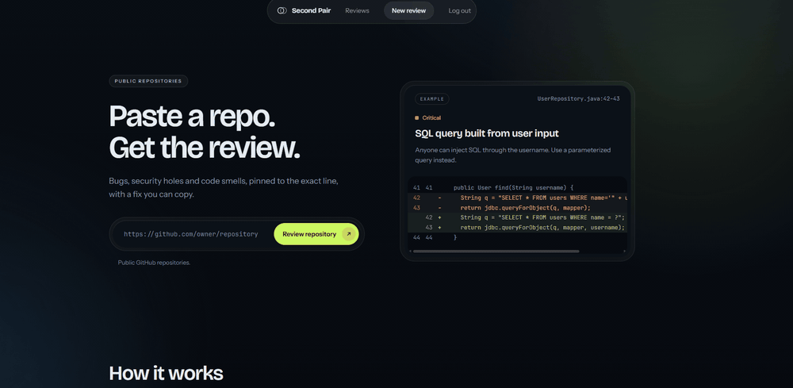

## What it does

You paste the URL of a public GitHub repository. The backend downloads the repository at its
latest commit, filters out what is not source code, sends the code to a language model in
chunks, checks every finding the model returns and computes the scores itself. The report
lists the findings by severity, with the affected lines and a suggested change.

It is a portfolio project that runs locally with one command. The model is optional: a fake
provider with fixed findings lets you try the whole flow without an API key.

## Screenshots

The report screens show a real review of a small public C# repository with Gemini.

| | |
|---|---|
| 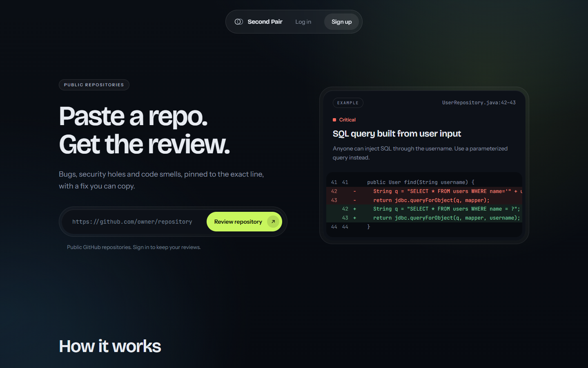 | **Landing page.** A repository URL is the only input; the example card shows the shape of a finding. |
| 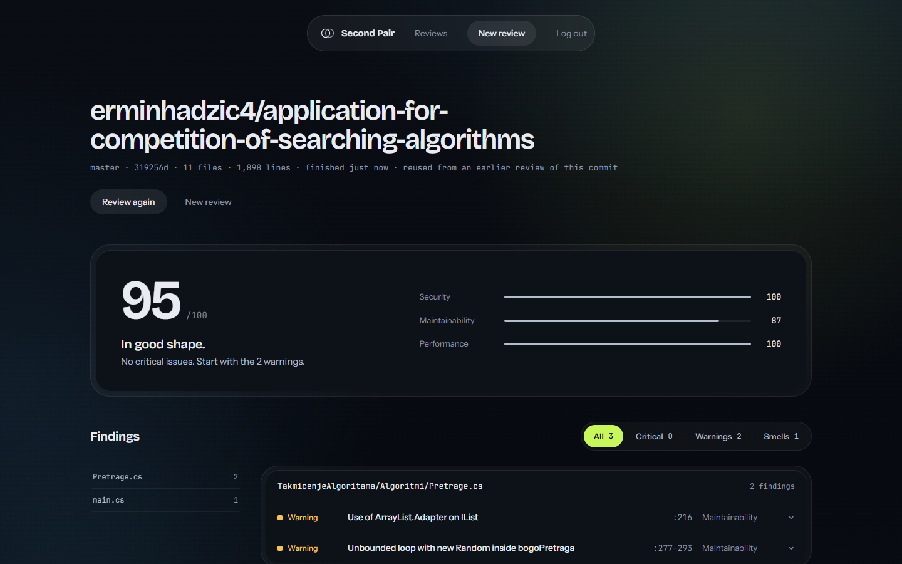 | **Report.** The overall score and the three category scores, computed from the findings, above the findings grouped by file. "Reused from an earlier review of this commit" marks a cached result. |
| 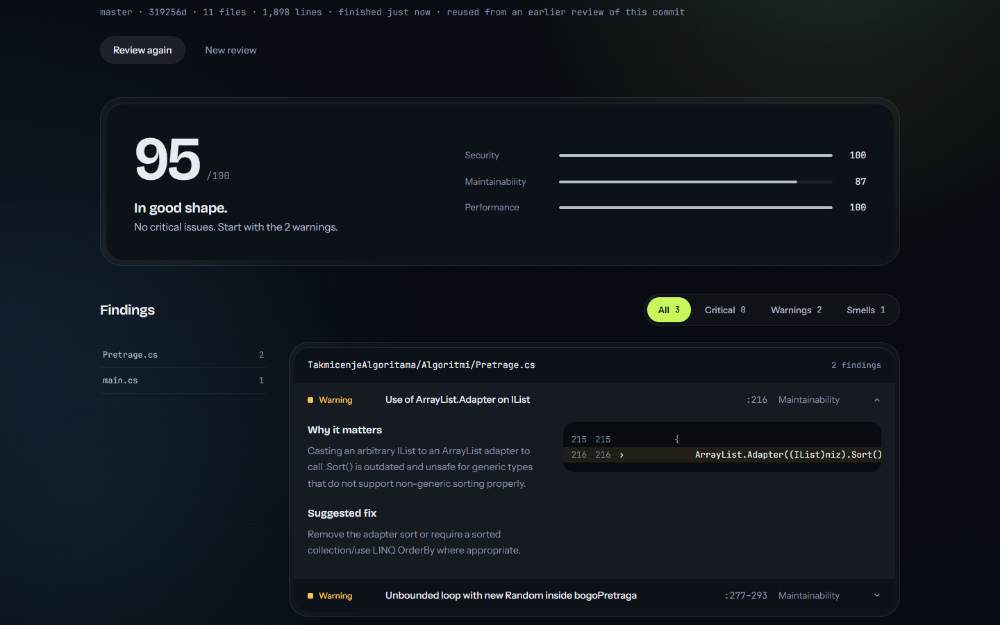 | **One finding.** Why it matters, the suggested fix and the cited lines cut from the file, with their real line numbers. |
| 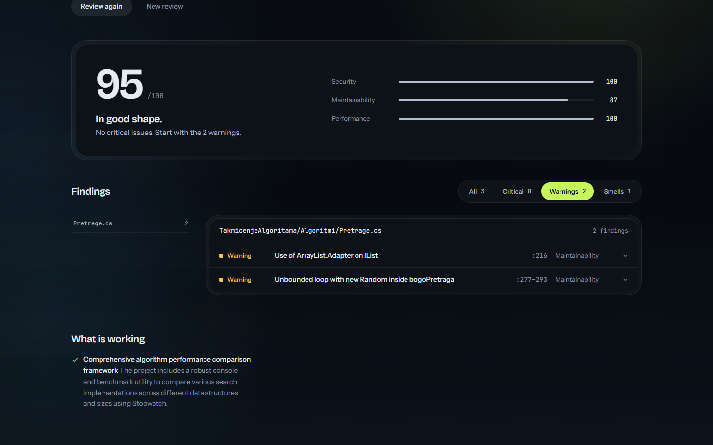 | **Filters and good practices.** Only warnings shown, the file list follows the filter, and "What is working" lists what the model found done well. |
| 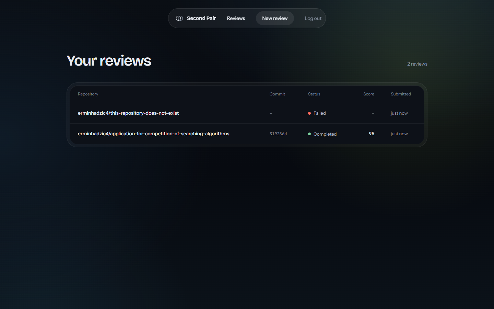 | **History.** Each user sees only their own reviews, with commit, status and score. |
| 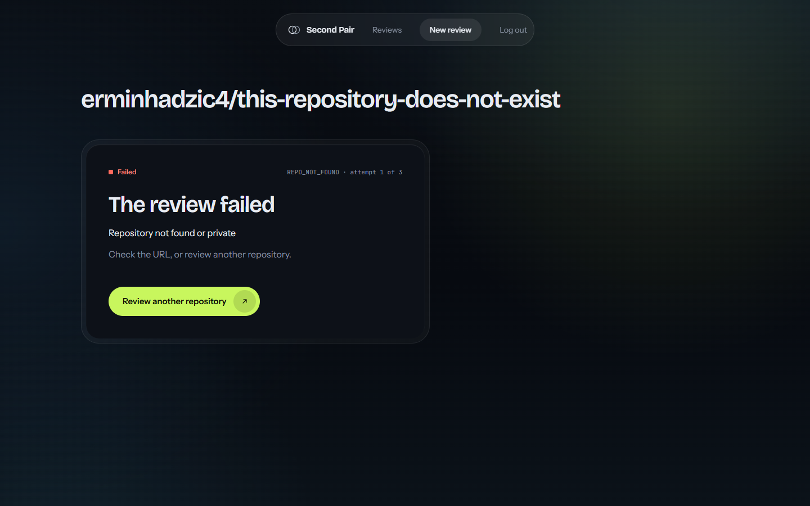 | **Failure.** A repository that does not exist fails at once with a clear reason and a way back. |
| 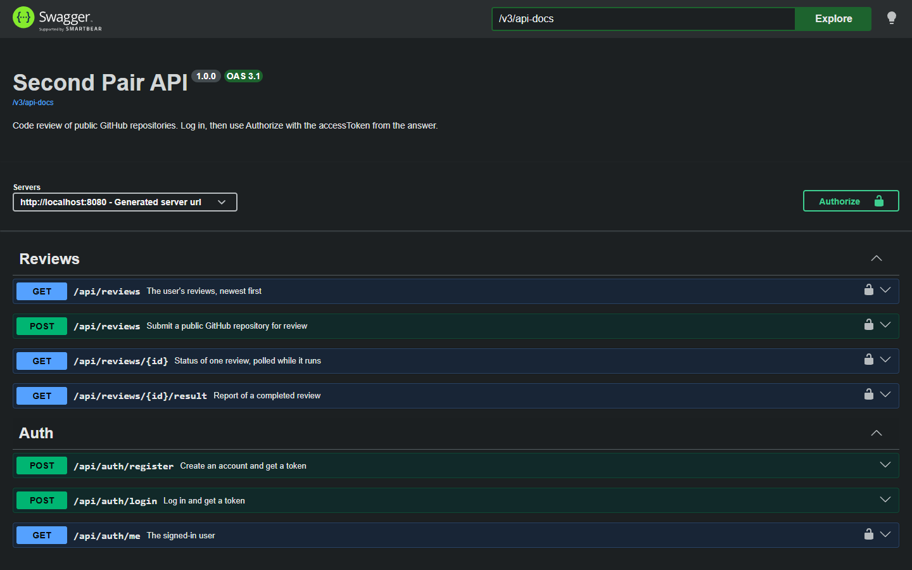 | **API documentation.** Swagger UI with the bearer token scheme; the endpoints with a lock need a token. |

## How a review works

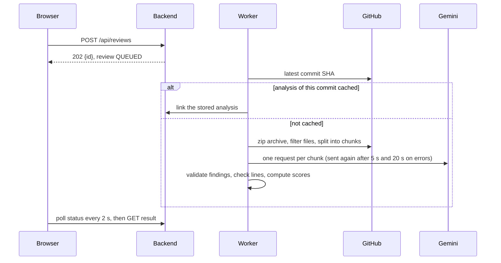

Reviews are asynchronous jobs: submit, poll the status, fetch the result. A result is cached
by repository, commit SHA, provider, model and prompt version, so the same commit is never
analysed twice. The full sequence and the review states are in
[docs/ARCHITECTURE.md](docs/ARCHITECTURE.md).

### What the score means

The score is computed by the backend from the findings, with an explicit formula. The model
never gives a score.

- Every issue costs its category points by severity: CRITICAL 30, HIGH 15, MEDIUM 6, LOW 3.
  Good practices cost nothing.
- A category score is `100 - penalty * 1000 / lines`, where `lines` is the number of lines
  reviewed, at least 1000, so the penalty is counted per 1000 lines. The result is rounded
  and never below 0.
- Overall = 0.40 security + 0.35 maintainability + 0.25 performance.

Example from a real review: 1 898 lines, maintainability issues HIGH + MEDIUM + LOW =
24 points, so maintainability is `100 - 24 * 1000 / 1898 = 87`; overall
`0.40 * 100 + 0.35 * 87 + 0.25 * 100 = 95`.

## Architecture

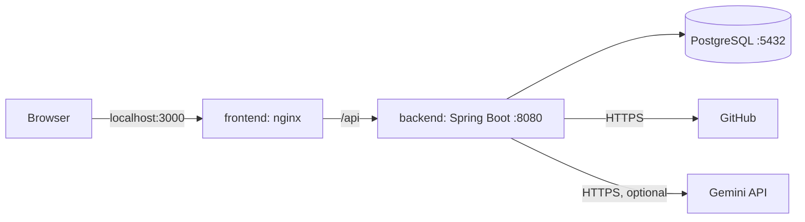

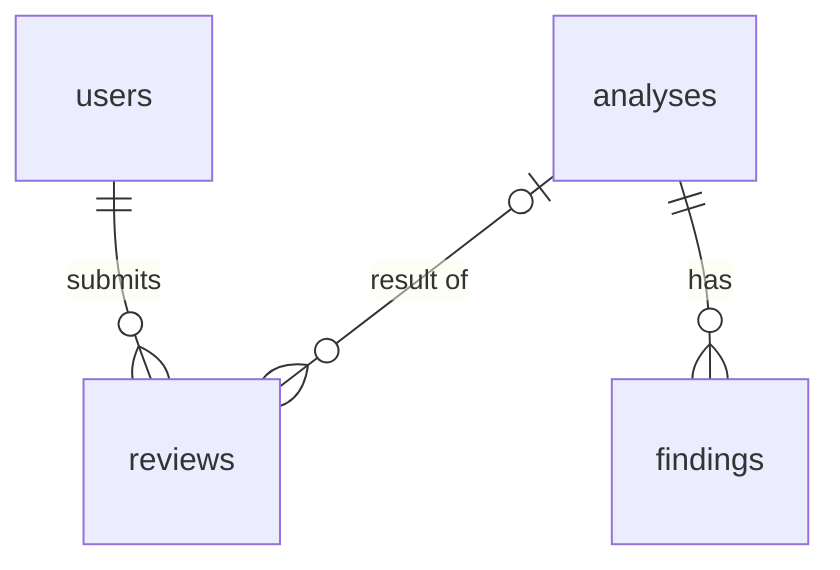

A `review` is one user's request and carries the job state. An `analysis` is the result for
one repository at one commit; it is shared by every review of that commit and acts as the
cache. Details: [docs/ARCHITECTURE.md](docs/ARCHITECTURE.md).

### Tech stack

| Part | Technology |
|---|---|
| Backend | Java 21, Spring Boot 4.0.8, Spring Security with JWT, Spring Data JPA, Flyway, Maven Wrapper |
| Database | PostgreSQL 18 |
| Frontend | React 19, React Router 7, Vite 8, TypeScript 6, CSS modules |
| API documentation | springdoc-openapi 3.0.3 (Swagger UI) |
| Model | Gemini API (free tier), behind a `CodeReviewProvider` interface |
| Tests | JUnit, Testcontainers, Vitest, Testing Library |
| Run and CI | Docker Compose, nginx, GitHub Actions |

## Getting started

### Prerequisites

- Git
- Docker Desktop (or Docker Engine with the Compose plugin)

Nothing else is needed to run the application; Java and Node.js are used inside the images.

### 1. Clone and configure

```bash
git clone https://github.com/erminhadzic4/ai-code-reviewer.git
cd ai-code-reviewer
cp .env.example .env
```

On Windows PowerShell use `Copy-Item .env.example .env` instead of `cp`.

### 2. Set JWT_SECRET

The backend refuses to start without a secret of at least 32 characters. Generate one and
put it in `.env` as `JWT_SECRET=...`.

Linux and macOS:

```bash
openssl rand -base64 48
```

Windows PowerShell:

```powershell
$b = New-Object byte[] 48; [Security.Cryptography.RandomNumberGenerator]::Create().GetBytes($b); [Convert]::ToBase64String($b)
```

> **Environment variables take precedence over `.env`.** Docker Compose uses a variable from
> your shell, or a Windows user or system environment variable, instead of the value in
> `.env`. If a change in `.env` seems to have no effect, check whether the same variable is
> set in your environment (for example `echo $env:JWT_SECRET` in PowerShell).

### 3. Start

```bash
docker compose up --build
```

The first build takes a few minutes. The database starts first, then the backend (it runs
the migrations), then the frontend. Check that all three services are `healthy`:

```bash
docker compose ps
```

| URL | What |
|---|---|
| http://localhost:3000 | the application |
| http://localhost:8080/swagger-ui.html | API documentation |
| http://localhost:8080/actuator/health | health of the backend |

All ports are published on `127.0.0.1` only.

### 4. First review with the fake provider

1. Open http://localhost:3000 and create an account (any email address and a password;
   nothing is sent anywhere).
2. Choose a new review and paste the URL of a public repository, for example
   `https://github.com/octocat/Spoon-Knife`.
3. The progress screen polls the job; the report opens when it is done.

With `REVIEW_PROVIDER=fake` the findings are fixed examples, but the repository is really
downloaded and filtered, so the flow is the same as with a model.

### 5. Switch to Gemini

1. Create a free API key at https://aistudio.google.com/apikey, in a Google project
   **without billing** (a project with billing is charged for every call).
2. In `.env` set:

   ```
   REVIEW_PROVIDER=gemini
   GEMINI_API_KEY=your-key
   GEMINI_MODEL=gemini-3.5-flash-lite
   ```

3. Apply the change with `docker compose up -d`; Compose recreates the backend.

On the free tier Google may use the submitted code to improve its products; only public
repositories are ever sent.

### 6. Stop and reset

```bash
docker compose down      # stops the application, keeps the data
docker compose down -v   # stops it and DELETES the database volume: all users and reviews
```

## Configuration

All variables are in [.env.example](.env.example).

| Variable | Default | Required | Purpose |
|---|---|---|---|
| `POSTGRES_DB` | `codereviewer` | yes | database name |
| `POSTGRES_USER` | `codereviewer` | yes | database user |
| `POSTGRES_PASSWORD` | `change-me` | yes | set when the volume is first created |
| `JWT_SECRET` | example value, rejected | yes | signs the access tokens, at least 32 characters |
| `GITHUB_TOKEN` | empty | no | raises the GitHub API limit from 60 to 5000 requests an hour; needs no scopes |
| `REVIEW_PROVIDER` | `fake` | no | `fake` or `gemini` |
| `GEMINI_API_KEY` | empty | with `gemini` | Gemini API key |
| `GEMINI_MODEL` | `gemini-3.5-flash-lite` | no | Gemini model |

## API

The API is described at http://localhost:8080/swagger-ui.html. Endpoints under
`/api/reviews` need a token: log in, then use **Authorize** in Swagger UI with the token
alone, or send it as a header:

```bash
TOKEN=$(curl -s -X POST http://localhost:8080/api/auth/login \
  -H "Content-Type: application/json" \
  -d '{"email":"you@example.com","password":"your-password"}' | sed -E 's/.*"accessToken":"([^"]+)".*/\1/')

curl -s -X POST http://localhost:8080/api/reviews \
  -H "Authorization: Bearer $TOKEN" -H "Content-Type: application/json" \
  -d '{"repoUrl":"https://github.com/octocat/Spoon-Knife"}'
```

The second call returns the review id; `GET /api/reviews/{id}` gives the status and
`GET /api/reviews/{id}/result` the report.

## Project structure

```
backend/    Spring Boot application: auth, GitHub client, providers, review jobs, scoring
frontend/   React application, served by nginx in its image
docs/       architecture, decisions, roadmap, demo media
.github/    CI workflow
docker-compose.yml, .env.example
```

## Development without Docker

The backend needs a PostgreSQL database; the simplest is the one from Compose
(`docker compose up -d db`). The backend reads `.env` from the repository root.

```bash
cd backend
./mvnw spring-boot:run   # API on http://localhost:8080
./mvnw verify            # tests; needs Docker for Testcontainers
```

```bash
cd frontend
npm ci
npm run dev              # http://localhost:5173, proxies /api to the backend
npm test
npm run lint
npm run build
```

## CI

GitHub Actions runs three jobs on every pull request and every push to `main`: the backend build with all
tests (`./mvnw -B verify`), the frontend lint, tests and build, and a build of both Docker
images.

## Limits of the findings

- **Findings can be wrong.** In a real review of a C# repository, a HIGH finding said that a
  loop creates a new `Random` on every pass. The `Random` is created once, before the loop.
  The loop is in fact unbounded, but for another reason (it never ends when the value is
  missing), so the title was partly right while the explanation and the fix were wrong.
  The report shows HIGH and MEDIUM together as "Warning".
- **One run is one sample.** The model's answers vary between runs of the same code.
- **Evidence rule.** Since prompt version 2, CRITICAL and HIGH findings must name the line
  where the failure happens and how it is triggered. It reduced unsupported findings in
  testing but does not prevent them.
- **What is checked.** The backend validates every finding against a fixed schema and
  checks that its file and lines exist; findings that fail are discarded and counted. It
  cannot check whether the explanation is true.
- **Public repositories only.** Size limits apply: at most 500 files and 2 MB of source
  after filtering, 200 KB per file.
- **Chunks.** The code is sent in chunks of up to 200 000 characters, so the model sees one
  chunk at a time, not the whole repository.
- **Cached results.** A commit is analysed once per provider, model and prompt version; a
  new review of the same commit returns the stored result.

## More

- [docs/ARCHITECTURE.md](docs/ARCHITECTURE.md): structure, data model, flow, running locally
- [docs/DECISIONS.md](docs/DECISIONS.md): design decisions and the alternatives rejected
- [docs/ROADMAP.md](docs/ROADMAP.md): milestones and what comes next

## License

[MIT](LICENSE)

## Author

Ermin Hadzic, [github.com/erminhadzic4](https://github.com/erminhadzic4)
